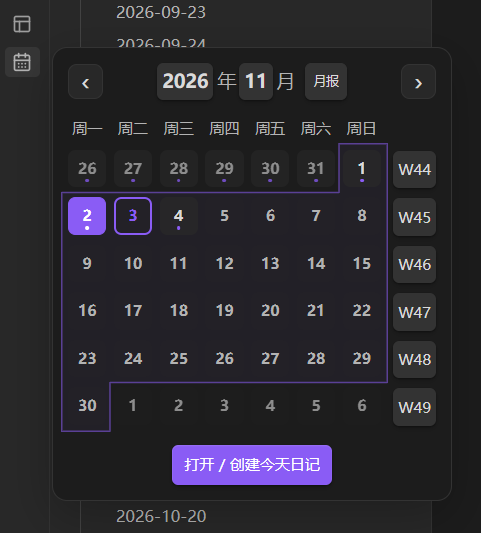
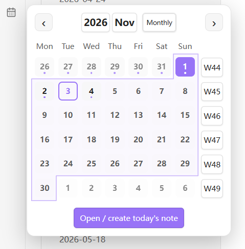
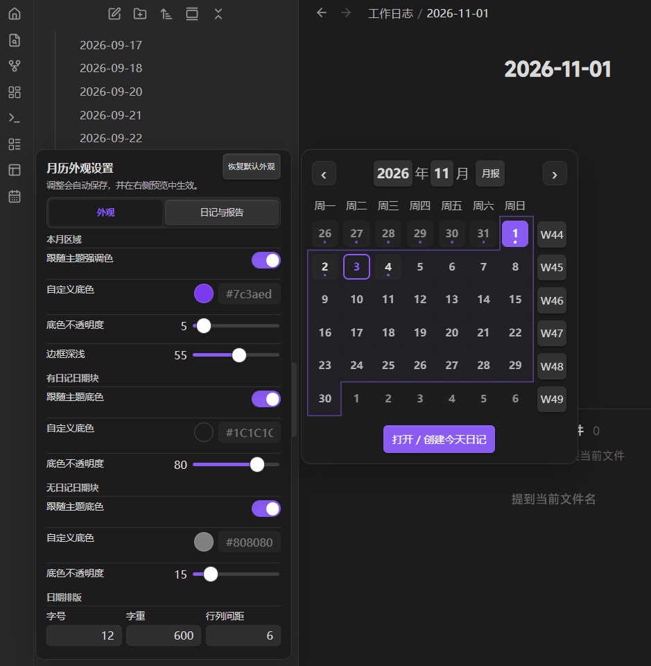
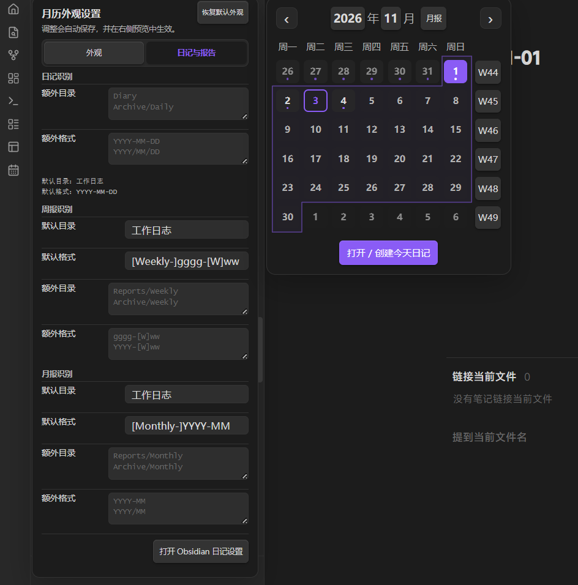

# Daily Notes Calendar

[English](README.en.md) · [中文](README.md)

An Obsidian plugin that shows a floating monthly calendar. It keeps Obsidian's original "Open today's daily note" ribbon action and adds a separate monthly calendar entry in the left ribbon.

## Preview

| Chinese / Dark | English / Light |
| --- | --- |
|  |  |

### Appearance settings with live preview



### Daily, weekly, and monthly note recognition



## Features

- Left-click the calendar icon to open the floating monthly calendar; right-click to open the settings with a live preview.
- Shows the current month's dates and distinguishes today, the currently open daily note, and dates that already have daily notes.
- Click a date to open or create the corresponding daily note, with quick year and month pickers.
- Open or create a weekly note via the `Www` button for each week, and a monthly note via the button next to the month.
- Automatically reads the folder and format from Obsidian's core Daily Notes plugin.
- Daily, weekly, and monthly notes all support additional folders and additional naming formats.
- Default weekly note format: `Weekly-YYYY-Www`; default monthly note format: `Monthly-YYYY-MM`.
- Appearance and note settings are on separate tabs; the interface supports both Chinese and English and follows the Obsidian theme.

## Installation

### Manual installation

1. Create the folder `.obsidian/plugins/daily-notes-calendar/` in your vault.
2. Copy `main.js`, `manifest.json`, and `styles.css` into that folder.
3. Restart Obsidian and enable **Daily Notes Calendar** under "Settings → Community plugins".
4. Make sure the core "Daily notes" plugin is enabled under "Settings → Core plugins".

## Usage

- **Left-click the calendar icon**: open or close the monthly calendar.
- **Right-click the calendar icon**: open or close the settings panel with live preview.
- **Click a date**: open an existing daily note, or create one according to your Obsidian daily notes settings.
- **Click a week number / monthly note button**: look for an existing report using the default and additional rules first; only create a new one if none is found.

Use the "Appearance" tab in settings to adjust colors and layout, and the "Daily Notes & Reports" tab to configure folders and naming formats. For fixed text in Moment.js format strings, wrap it in square brackets, e.g. `[Weekly-]gggg-[W]ww`.

## Development

Requires Node.js.

```bash
npm install
npm run build
```

Rebuild automatically while developing:

```bash
npm run dev
```

## License

[MIT](LICENSE)
