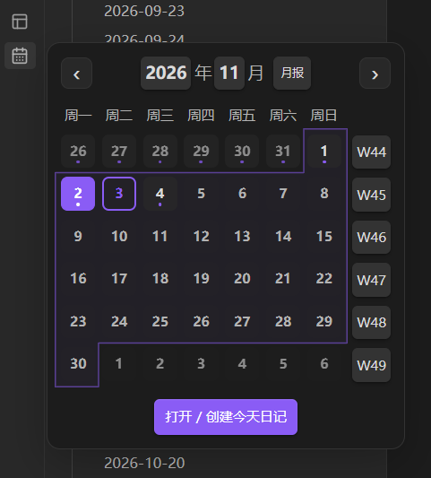
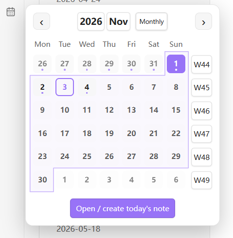
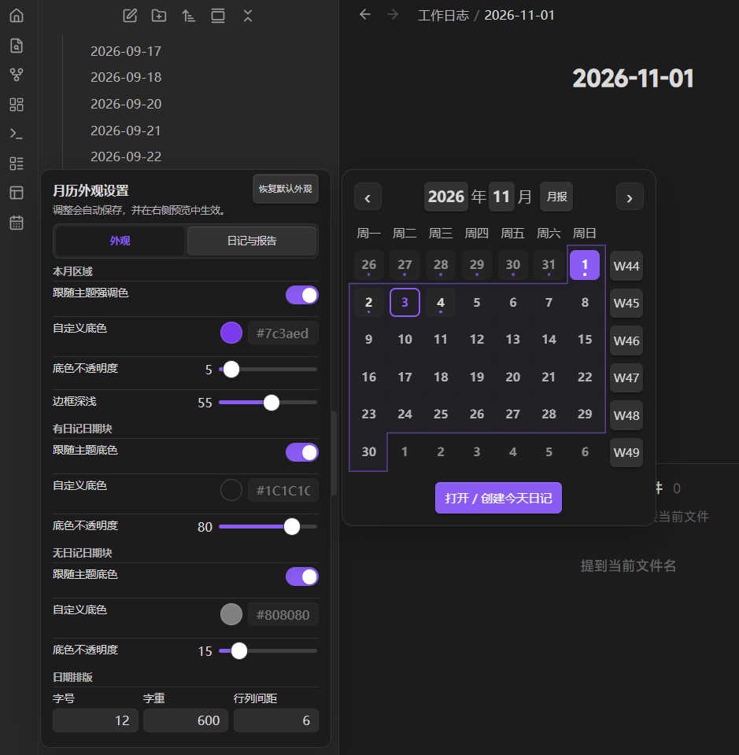
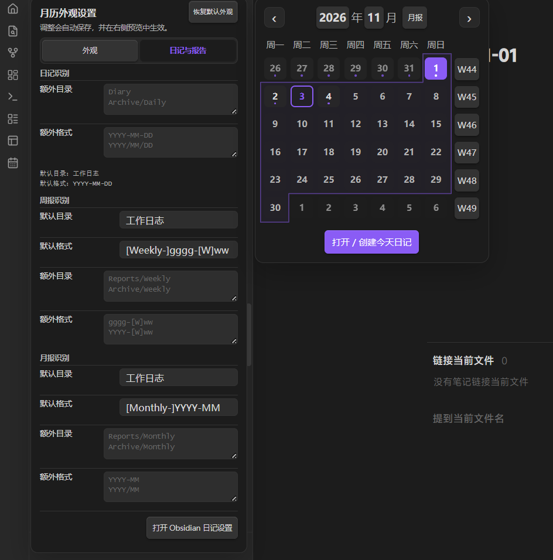

# Daily Notes Calendar

[English](README.en.md) · 中文

一个用于 Obsidian 的悬浮月历插件。保留 Obsidian 原来的“打开/创建今天日记”按钮，并在左侧功能区提供独立的月历入口。

## 功能预览

| 中文暗色 | English / Light |
| --- | --- |
|  |  |

### 外观设置与实时预览



### 日记、周报与月报识别



## 功能

- 左键点击日历图标打开悬浮月历，右键打开设置与实时预览。
- 显示本月日期，区分今天、当前打开的日记和已有日记的日期。
- 点击日期打开或创建对应日记，支持快速选择年份和月份。
- 通过每周的 `Www` 按钮打开或创建周报，通过月份旁的按钮打开或创建月报。
- 自动读取 Obsidian 核心“日记”插件的目录和格式。
- 日记、周报、月报均支持额外目录和额外命名格式。
- 默认周报格式：`Weekly-YYYY-Www`；默认月报格式：`Monthly-YYYY-MM`。
- 外观与笔记配置分开展示，支持中英文界面，并跟随 Obsidian 主题颜色。

## 安装

### 手动安装

1. 在你的库中创建目录：`.obsidian/plugins/daily-notes-calendar/`。
2. 将 `main.js`、`manifest.json` 和 `styles.css` 复制到该目录。
3. 重启 Obsidian，在“设置 → 第三方插件”中启用 **Daily Notes Calendar**。
4. 确保“设置 → 核心插件”中的“日记”已启用。

## 使用

- **左键日历图标**：打开或关闭月历。
- **右键日历图标**：打开或关闭设置面板及实时预览。
- **点击日期**：打开已有日记，或按 Obsidian 日记设置创建新日记。
- **点击周数 / 月报**：先按默认和额外规则查找已有报告，未找到时才按默认规则创建。

设置中的“外观”页签用于调整颜色和排版；“日记与报告”页签用于配置目录及命名格式。Moment.js 格式字符串中的固定文字请放在方括号中，例如 `[Weekly-]gggg-[W]ww`。

## 开发

需要 Node.js。

```bash
npm install
npm run build
```

开发时自动重新构建：

```bash
npm run dev
```

## 许可证

[MIT](LICENSE)
